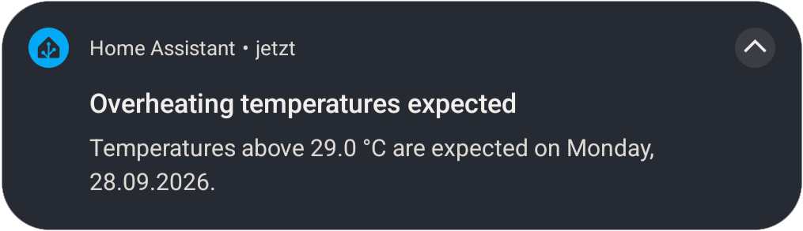
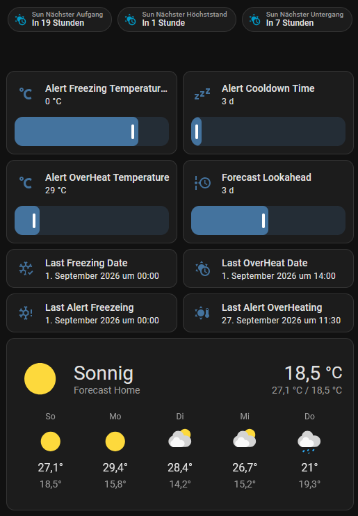

# Forecast Temperature Threshold alert

This automation pings your Phone if in the next N days the temperature is above or below a setable threshold.

It only uses the default Weather forecast from met.no, delivered by the Norwegian Meteorological Institute.

# Setup

## Weather App
The App met.no is preinstalled in home assistand (at least it was in version ) You can adapt the scripts to use other weather apps with HACS if you like. Make sure you set up the weatherapp correctly: Your home postion AND **elevation over nn**!

## Notification group
Define which mobieles shall receive the message.
-> Mobilephones must have installed tha Home Assistant app and can log in.

## Inputs/helper
Define the following inputs in **Settings -> Devices & services -> Helpers -> + Create helper**

 - input_datetime.last_overheat_date  
 - input_datetime.last_freezing_date    
 - input_datetime.last_alert_overheating 
 - input_datetime.last_alert_freezeing   
 - input_number.alert_cooldown_time                   
 - input_number.alert_freezing_temperature_threshold
 - input_number.alert_overheat_temperature
 - input_number.forecast_lookahead
 - notify.all_phones   (Create helper → Group → Notify group)

 -> you can add these as controlls to a dashboard. The ranges depend under which circumstances you want to be alerted.

My setup: 
- input_number.alert_cooldown_time                   **[1 - 30] set to 3**
- input_number.alert_freezing_temperature_threshold  **[-20 - 5] set to 0**
- input_number.alert_overheat_temperature            **[25 - 50] set to 29**
- input_number.forecast_lookahead                    **[1 - 5] set to 3**

 -> Even though the input_datetime.* are not supposed to be set by you, I like to add them as controlls, so I can set them into the past to see if the automation works.

 

 ## Install the automations
In **Settings -> Automations & Scenes -> + Create automation -> tree dots -> edit in yaml** 
copy and past the scripts each:
 - [automation_freezing_warning.yml](automation_freezing_warning.yml)
 - [automation_overheating_warning.yml](automation_overheating_warning.yml)
 - [automation_record_freezing_temperature.yml](automation_record_freezing_temperature.yml)
 - [automation_record_overheat_temperature.yml](automation_record_overheat_temperature.yml)

 Test it by setting the input_datetime way into the past + depending on your forecast you need to set the thresholds such that the alert goes of.